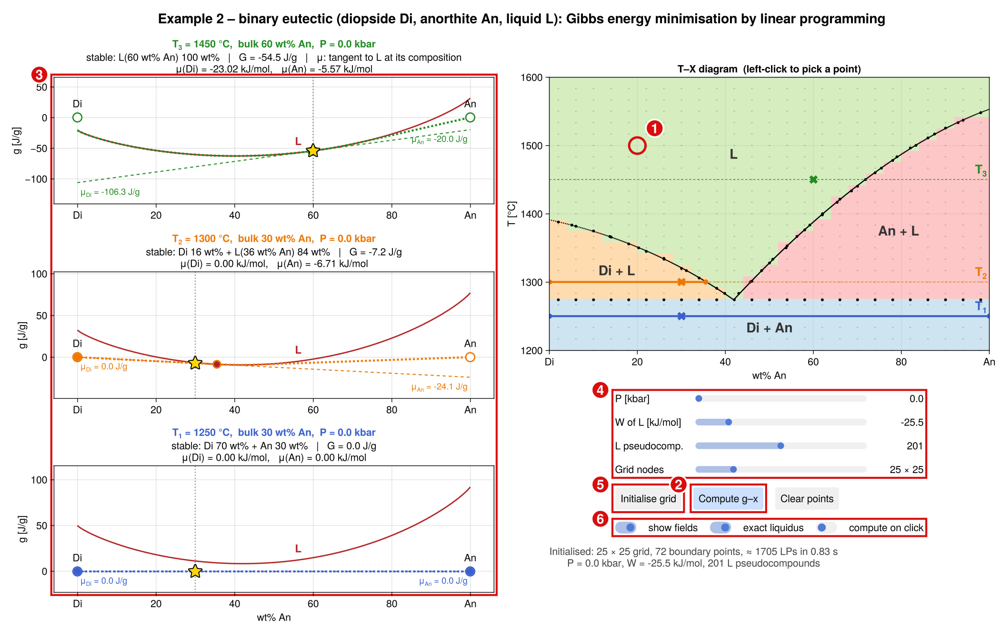
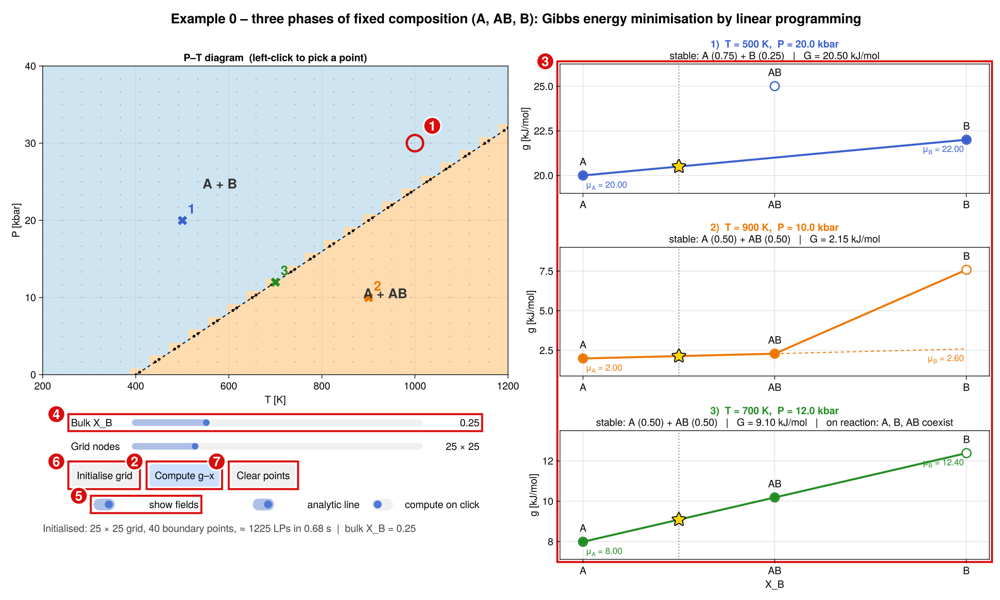
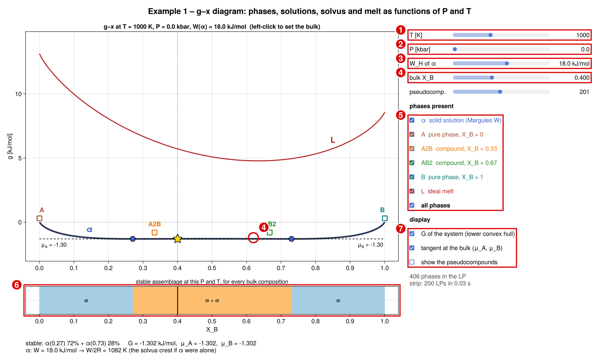
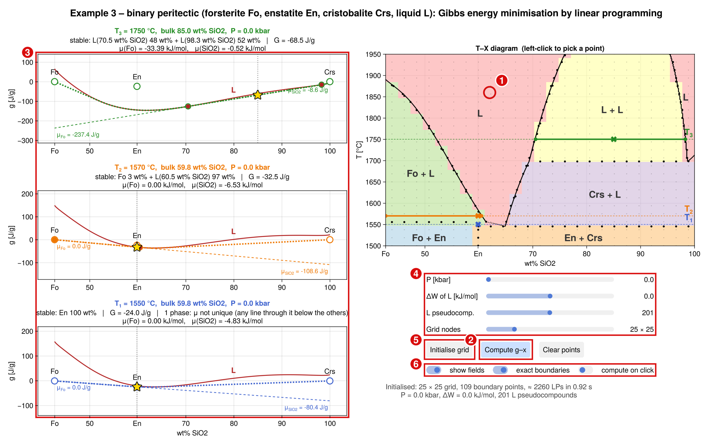
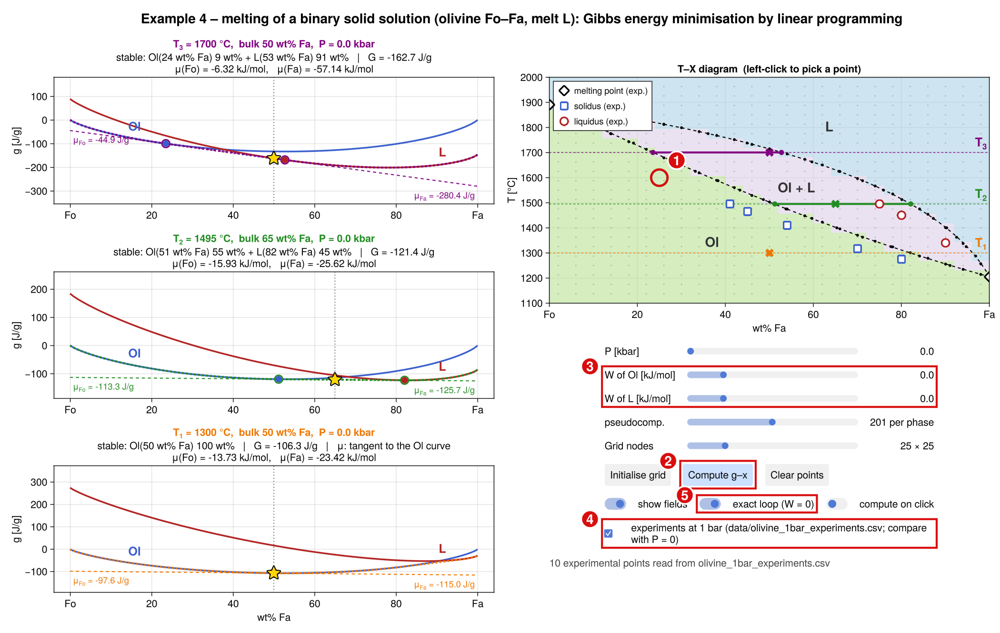
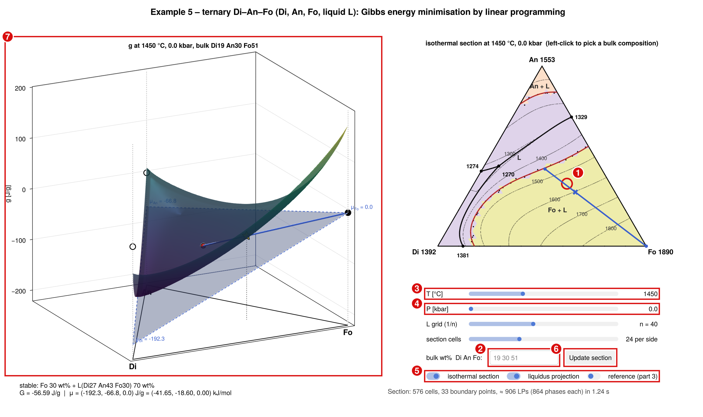

# Interactive phase equilibria with Julia

Interactive teaching programs that show how the **stable mineral assemblage** follows from
**minimising the Gibbs energy** of a system. Click a point in a phase diagram and see the
Gibbs energy–composition ($g$–$x$) diagram that explains why that assemblage is stable: the
lower convex hull, the common tangent and the chemical potentials.

Every example uses the same small core. Each phase has a Gibbs energy $g(P,T)$, solutions are
split into many *pseudocompounds*, and the minimisation is solved as a **linear programme**
(JuMP + GLPK). The graphics use [GLMakie](https://docs.makie.org/).



> **Full documentation:** [guide/guide.pdf](guide/guide.pdf) covers the theory, the set-up of the
> linear programme, the calibrations and an annotated, step-by-step walkthrough of every example.

---

## The examples

| File | Diagram | Topic |
|---|---|---|
| [`Example0_fixed_composition.jl`](Example0_fixed_composition.jl) | $P$–$T$ | Three phases of fixed composition (A, AB, B) and a univariant reaction |
| [`Example1_solution_playground.jl`](Example1_solution_playground.jl) | $g$–$x$ | Solid solution with a solvus, compounds and a melt; switch phases on and off, live with $P$ and $T$ |
| [`Example2_eutectic_TX.jl`](Example2_eutectic_TX.jl) | $T$–$X$ | Binary eutectic diopside–anorthite (Di–An) |
| [`Example3_peritectic_TX.jl`](Example3_peritectic_TX.jl) | $T$–$X$ | Binary peritectic forsterite–silica (Fo–SiO₂): enstatite melts incongruently; two liquids |
| [`Example4_olivine_loop_TX.jl`](Example4_olivine_loop_TX.jl) | $T$–$X$ | Melting loop of a solid solution (olivine Fo–Fa), compared with 1 bar experiments |
| [`Example5_ternary_DiAnFo.jl`](Example5_ternary_DiAnFo.jl) | ternary + 3D | Di–An–Fo: isothermal sections, liquidus projection and the $g$ surface with its tangent plane |

<table>
<tr>
<td width="50%"><br><sub><b>Example 0</b>: P–T diagram with the g–x diagrams of three picked points</sub></td>
<td width="50%"><br><sub><b>Example 1</b>: the solution playground at 1000 K (α + α solvus)</sub></td>
</tr>
<tr>
<td><br><sub><b>Example 3</b>: Fo–SiO₂ peritectic and the two-liquid field</sub></td>
<td><br><sub><b>Example 4</b>: olivine melting loop with experimental data</sub></td>
</tr>
<tr>
<td colspan="2"><br><sub><b>Example 5</b>: the Di–An–Fo ternary at 1450 °C, bulk Di19 An30 Fo51 (Fo + L)</sub></td>
</tr>
</table>

---

## Installation

1. **Install Julia.** The recommended installer is [juliaup](https://julialang.org/downloads/):

   ```sh
   curl -fsSL https://install.julialang.org | sh      # macOS / Linux
   ```

   On Windows, install *Julia* from the Microsoft Store. The `Manifest.toml` was resolved with
   Julia 1.13. With an older Julia, `Pkg.instantiate()` may have to resolve the package versions again.

2. **Get the code:**

   ```sh
   git clone <repository-url> julia_interactive_thermo
   cd julia_interactive_thermo
   ```

3. **Install the packages** (GLMakie, JuMP, GLPK). This runs once and takes several minutes:

   ```sh
   julia --project=. -e "using Pkg; Pkg.instantiate()"
   ```

## Running an example

From a terminal in the main folder:

```sh
julia Example2_eutectic_TX.jl
```

Each script activates the project itself (`Pkg.activate(@__DIR__)`), so no extra flags are
needed. A window opens and the program runs until you close it. You can also start an example
from the Julia REPL or from VS Code:

```julia
julia> include("Example2_eutectic_TX.jl")
```

**Notes**

- The first start takes 30–60 s while Julia compiles the graphics and the solver. After that,
  the programs respond immediately.
- GLMakie needs working **OpenGL** drivers. It usually does not work on remote or headless machines.
- Two examples cannot be loaded one after the other into the *same* Julia session, because they
  define the same names. Restart Julia between examples.
- The window opens with at most 85 % × 80 % of the screen. To change this limit, edit
  `WINDOW_FRACTION` in [`window_size.jl`](window_size.jl).

### Using the interface

- **Left-click** in a phase diagram to pick a point (in Example 5, a bulk composition in the triangle).
- Click **Compute g–x** to draw the $g$–$x$ diagram of that point. You can also switch on
  *compute on click* to skip this step.
- **Sliders** change $P$, $T$, the bulk composition, the Margules parameters, the number of
  pseudocompounds and the grid resolution.
- **Toggles** hide the coloured stability fields, so that students can find the topology
  themselves, and show the exact (analytic) boundaries as a check of the LP.
- The **status lines** show the stable assemblage under the cursor, the number of LPs solved and the time taken.

Every program starts with a **`USER INPUT`** block, where you can change the thermodynamic data
(energies, entropies, volumes, melting data, Margules parameters) and the diagram ranges. Save
the file and run it again.

---

## How it works

**Phases of fixed composition** (no heat capacity, no compressibility or thermal expansion):

$$g(P,T) = g_0 - s\,T + v\,P$$

**Melts** are defined relative to the solid with the same composition, using the enthalpy of fusion $\Delta H$,
the melting point $T_m$ and the volume of fusion $\Delta V$:

$$g^{l} - g^{s} = \Delta H\left(1 - \frac{T}{T_m}\right) + \Delta V\,P$$

**Binary solutions** (ideal mixing on $n$ sites plus a regular-solution / Margules term):

$$g(X) = (1-X)\,g_1 + X\,g_2 + nRT\left[X\ln X + (1-X)\ln(1-X)\right] + W\,X(1-X), \qquad W = W_H - T\,W_S + P\,W_V$$

At a fixed $X$, a solution is again linear in $P$ and $T$, so it is replaced by many
**pseudocompounds** of fixed composition (201 by default).

**Gibbs energy minimisation as a linear programme.** $\alpha_i$ is the amount of phase $i$ and
$A_{ji}$ is the mole fraction of component $j$ in phase $i$:

$$\min_{\alpha}\; G = \sum_i g_i\,\alpha_i \quad\text{subject to}\quad \sum_i A_{ji}\,\alpha_i = b_j,\qquad \alpha_i \ge 0$$

- The phases with $\alpha_i > 0$ make up the **stable assemblage**, and the $\alpha_i$ are their proportions (lever rule).
- The **dual variables** of the mass-balance constraints are the **chemical potentials** $\mu_j$.
  The tangent $g = \sum_j \mu_j X_j$ touches every stable phase and lies below every metastable one,
  which is the common-tangent construction.
- At most $c$ phases coexist at fixed $P$ and $T$ (**phase rule**).
- **Phase diagrams** come from solving the LP on a grid. Field boundaries are located by
  bisection between neighbouring grid nodes that have different assemblages.

The JuMP model is built once. Only the costs $g_i$ or the right-hand side $b_j$ are updated, so the
programs can solve thousands of LPs per second.

**Moles in the calculation, weight per cent in the plots.** All thermodynamics is done in moles,
because ideal mixing counts particles. Examples 2–5 are *displayed* in wt % and $g$ per gram,
so that they can be compared directly with the published diagrams. A tangent that is a straight
line (or plane) in mole fraction and $g$ per mole stays straight in wt % and $g$ per gram.

### Using the core without graphics

[`gibbs_lp.jl`](gibbs_lp.jl) does not depend on the plotting package:

```julia
using Pkg; Pkg.activate(".")
include("gibbs_lp.jl")

phases = [Phase("A",  [1.0, 0.0], 10.0, 0.020, 1.00),   # name, composition, g0, s, v
          Phase("B",  [0.0, 1.0], 14.0, 0.016, 0.80),
          Phase("AB", [0.5, 0.5], 16.0, 0.028, 1.15)]

lp = GibbsLP(phases, [0.75, 0.25])   # bulk composition X_B = 0.25
r  = solve!(lp, 20.0, 500.0)         # P = 20 kbar, T = 500 K

r.stable   # [1, 2]            -> A + B
r.α        # [0.75, 0.25, 0.0]
r.μ        # [20.0, 22.0]      chemical potentials of A and B
```

Units: $g$ in kJ/mol, $s$ in kJ/(mol K), $v$ in kJ/(kbar mol) (1 kJ/kbar = 10 cm³), $T$ in K, $P$ in kbar.

---

## Calibration against published diagrams

Examples 2, 3 and 5 reproduce published phase diagrams. The curves were digitised in wt %,
converted to mole fractions, and the melt parameters were fitted to them. The fitted values are
parameters of these simple models, not calorimetric values.

| System | Model | Published diagram |
|---|---|---|
| Di–An eutectic (Ex. 2) | 1274 °C, 41.9 wt % An | 1274 °C, 42 wt % An |
| Fo–SiO₂ peritectic (Ex. 3) | 1555.5 °C, melt 61.3 wt % SiO₂ | 1557 °C, ≈ 61.3 wt % |
| En–Crs eutectic (Ex. 3) | 1545.3 °C, melt 64.8 wt % SiO₂ | 1543 °C, ≈ 65.0 wt % |
| Di–An–Fo ternary eutectic (Ex. 5) | 1269 °C, Di49 An44 Fo07 | 1270 °C, Di49 An44 Fo07 |

The fits can be repeated:

```sh
julia calibration/fit_Example2_DiAn.jl
julia calibration/fit_Example3_FoSiO2.jl
```

---

## Repository layout

```
.
├── Example0_fixed_composition.jl     P–T, phases of fixed composition
├── Example1_solution_playground.jl   live g–x diagram
├── Example2_eutectic_TX.jl           Di–An eutectic
├── Example3_peritectic_TX.jl         Fo–SiO₂ peritectic
├── Example4_olivine_loop_TX.jl       olivine melting loop
├── Example5_ternary_DiAnFo.jl        Di–An–Fo ternary
├── gibbs_lp.jl                       common core: Gibbs energies + linear programme
├── window_size.jl                    fits the window to the screen at start-up
├── Project.toml, Manifest.toml       Julia environment
├── calibration/                      fits of the melt models (Examples 2 and 3)
├── data/
│   ├── DiAn_liquidus_digitized.txt         digitised liquidus, Example 2
│   ├── FoSiO2_liquidus_Morse_digitized.txt digitised diagram, Example 3
│   └── olivine_1bar_experiments.csv        experimental data, Example 4
├── guide/
│   ├── guide.tex, guide.pdf          the user guide
│   ├── make_screenshots.jl           regenerates the annotated screenshots
│   └── figures/
└── repo/                             earlier course material (parts 1–4)
```

The experimental data for Example 4 are a plain CSV file (`T_C, type, Fa, unit, source`). The file
is read again every time the *experiments at 1 bar* box is ticked, so you can add your own
measurements while the program is running.

To regenerate the screenshots in the guide, run the following and then recompile `guide/guide.tex`:

```sh
julia guide/make_screenshots.jl all
```

---

## Troubleshooting

| Problem | Fix |
|---|---|
| `Package … not found` | Run `julia --project=. -e "using Pkg; Pkg.instantiate()"` in the main folder |
| No window appears | GLMakie needs OpenGL; run on a local machine with working graphics drivers |
| Slow first start | Normal (compilation); later interactions are fast |
| Program reacts slowly | Reduce the number of pseudocompounds, grid nodes or section cells |
| Window too large | Reduce `WINDOW_FRACTION` in `window_size.jl`, e.g. to `(0.7, 0.7)` |
| Edited data have no effect | The `USER INPUT` block is read at start-up: save the file and restart the program |

---

## Author

Evangelos Moulas, made with the help of Claude.
